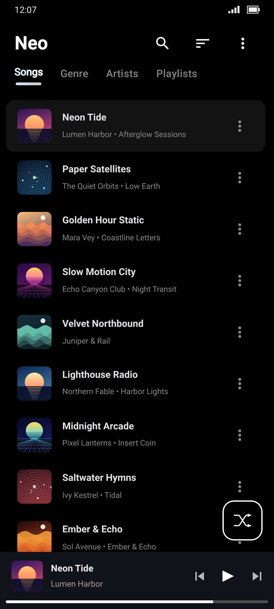
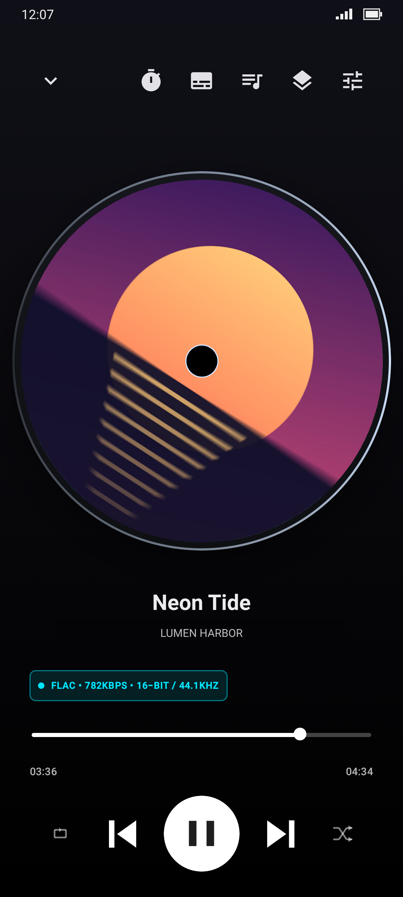

# Neo Player

A clean, offline music player for Android. Neo plays the music already on your phone. There are no accounts, no streaming and no ads.

<p align="center">
  
  &nbsp;&nbsp;
  
</p>

<p align="center"><sub>Album art and song names in these screenshots are fictional.</sub></p>

## Features

**Library**
- Browse by songs, genres, artists, albums and playlists, with customizable and reorderable tabs
- Load music from the Android media library or from folders you choose, with excluded folders
- Search across titles, artists, albums, lyrics and tags, with `genre:`, `year:` and `tag:` filters
- Natural sorting, so "Track 2" comes before "Track 10"
- Album art in the lists and at full resolution in the player

**Playback**
- Gapless playback powered by Media3 / ExoPlayer
- Queue with drag-to-reorder, swipe-to-remove and "play next"
- Shuffle and repeat
- Sleep timer, either by duration or at the end of the current track
- Resumes your queue and position after a restart
- Notification, lock-screen and headphone controls
- Audio quality badge showing format, bitrate, bit depth and sample rate
- Hands off to the system equalizer

**Now Playing**
- Swipe between covers with an animated carousel transition
- Album art styles: rotating CD (spin it to scrub), rounded, square, cookie and soft burst
- Synchronized (LRC) and plain lyrics embedded in your files
- **Neo Retro** theme, a cassette-deck player with spinning reels

**Playlists**
- Create, rename, reorder and delete playlists, and set a custom cover
- Playlists remember songs by a stable ID, so they survive rescans and moved files
- Import and export M3U / M3U8
- Automatic Recently Played, Most Played and Recently Added lists

**Personalization**
- Several dark color themes, Material You and pure AMOLED black
- Driver Mode: optional location-based volume adjustment
- Home screen widget

## Requirements

- Android 7.0 (API 24) or newer
- Access to your music (the app asks for permission on first use)

## Building

1. Install [Android Studio](https://developer.android.com/studio) (it includes JDK 17).
2. Clone the repository:
   ```bash
   git clone https://github.com/boltlights/neo-player.git
   ```
3. Open the folder in Android Studio and let it sync Gradle.
4. Run the `app` configuration on a device or emulator.

Unit tests run with the `testDebugUnitTest` Gradle task (Robolectric, SDK 35).

### Tech stack

| Area | Library |
|---|---|
| Language / UI | Kotlin 2.2, Jetpack Compose, Material 3 |
| Playback | AndroidX Media3 1.5 (ExoPlayer, MediaSession) |
| Storage | Room (SQLite) |
| Images | Coil |
| Tag reading | jaudiotagger, Android MediaMetadataRetriever |

## Known limitations

- **Lyrics** are read only from tags inside the audio file. Separate `.lrc` files are not supported yet.
- **ReplayGain** volume normalization is still being verified and may not apply to every file.
- **Android Auto** shows the library, but starting playback from the car is not finished yet.

## Contributing

Bug reports and pull requests are welcome. Please open an issue first for larger changes, so we can agree on the approach.

## Acknowledgements

- [Auxio](https://github.com/OxygenCobalt/Auxio), whose cover-swipe design and stable song IDs inspired Neo's own implementations. No Auxio code is included.
- The open-source libraries listed under the tech stack.

## License

Neo Player is released under the [MIT License](LICENSE).
